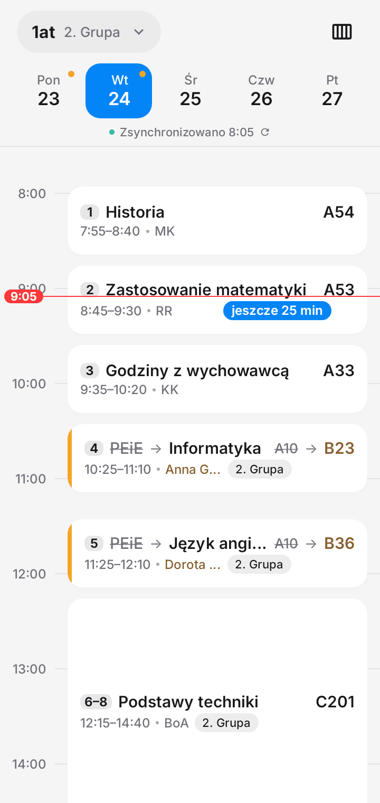
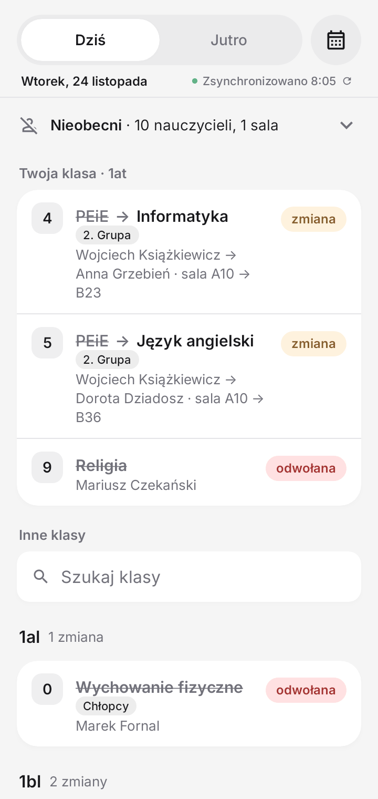
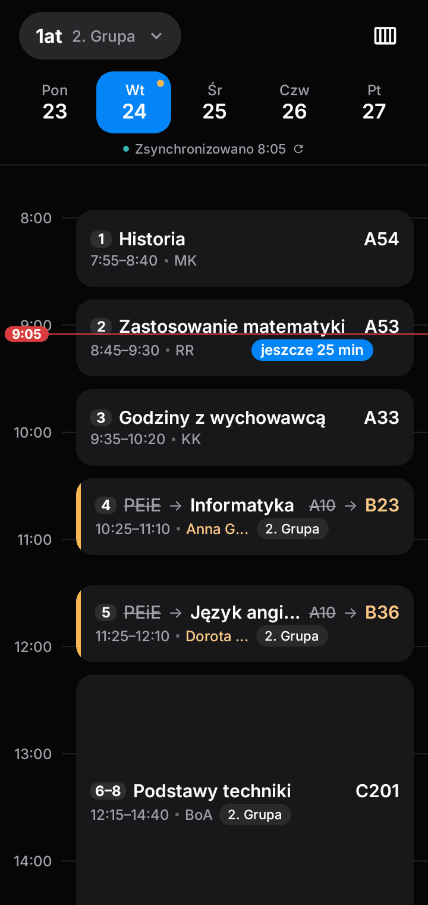
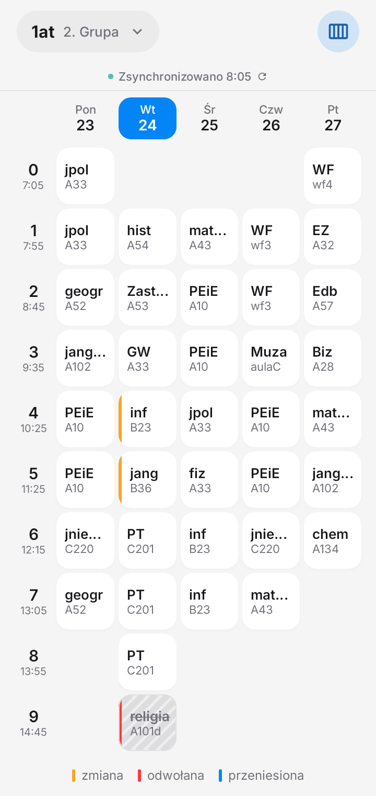
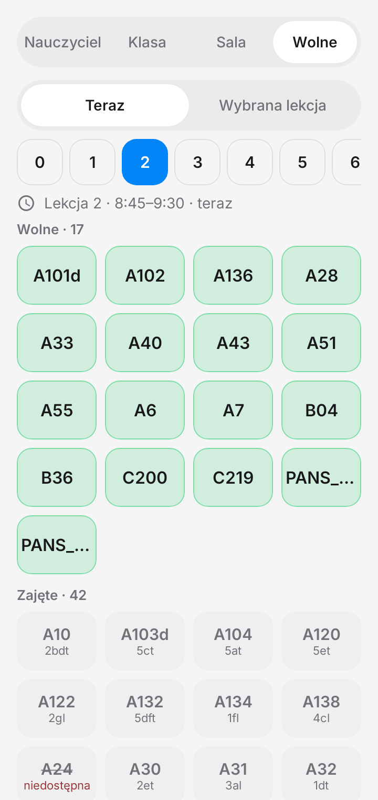
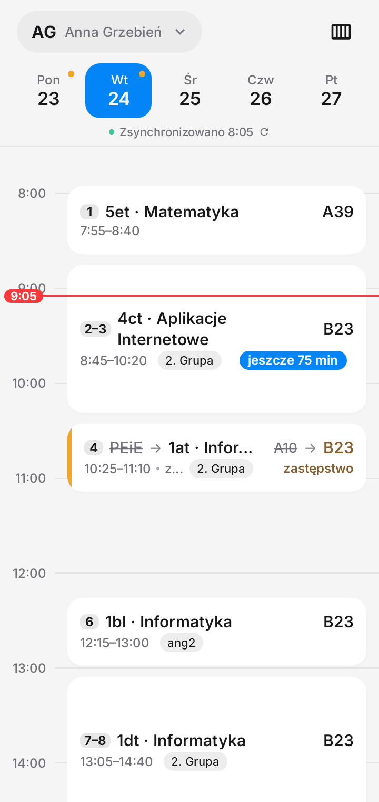

# E-Plan

Plan lekcji i zastępstwa dla **ZSP nr 5 w Krośnie (Elektryk)** na Androida.
Twój plan z naniesionymi zastępstwami, od razu po otwarciu, także bez internetu.

  
  
  

> **Nieoficjalna.** Aplikacja nie jest powiązana ze szkołą ani z firmą EduPage.
> Pokazuje tylko to, co szkoła publikuje na [elektryk.edupage.org](https://elektryk.edupage.org)
> bez logowania.

## Co potrafi

- **Twój plan, już z zastępstwami.** Wybierasz klasę i swoje grupy (albo, jeśli uczysz,
  swoje nazwisko) i widzisz dokładnie swoje lekcje. Odwołania, zmiany sal i nauczycieli
  są od razu zaznaczone.
- **Co teraz i ile do dzwonka.** Pasek na górze pokazuje bieżącą lekcję albo przerwę
  i odlicza czas.
- **Powiadomienia o zmianach.** Gdy w Twoim planie pojawi się zastępstwo, odwołanie albo
  zmiana sali, telefon da znać. Tylko o tym, co dotyczy Ciebie. W weekend może milczeć.
- **Wszystkie zastępstwa dnia.** Kto jest nieobecny, które sale są zajęte, zmiany
  w Twojej klasie na górze listy. Dowolny dzień z kalendarza.
- **Szukaj.** Plan dowolnego nauczyciela, sali albo klasy oraz **wolne sale** teraz
  albo na wybranej lekcji.
- **Działa offline.** Ostatnio pobrany plan jest zawsze pod ręką, także bez zasięgu.
- **Jasny i ciemny motyw**, lekka i szybka także na tańszych telefonach.

  
  
  

## Instalacja

1. Wejdź w [**Releases**](../../releases/latest) i pobierz plik `E-Plan-….apk`.
2. Otwórz go na telefonie. Jeśli Android zapyta, zezwól przeglądarce albo menedżerowi
   plików na instalowanie aplikacji.
3. Wybierz, czy jesteś uczniem, czy nauczycielem, ustaw klasę i grupy. Gotowe.

Wymaga Androida 8.0 lub nowszego. Aplikacji nie ma w Sklepie Play. Nowe wersje instalujesz
tak samo, na starą: profil i ustawienia zostają.

## Prywatność

Bez konta i bez logowania. Twój profil (klasa, grupy, nazwisko nauczyciela) zostaje
na telefonie. Aplikacja łączy się tylko z publicznym planem szkoły. Powiadomienia
przychodzą przez Firebase Cloud Messaging: telefon zapisuje się na kanał swojej klasy
(albo nauczyciela) i nic więcej o Tobie nie wysyła.

## Błędy i pomysły

Coś się nie zgadza z planem albo apka się zamknęła? Zgłoś to w
[**Issues**](../../issues). Przy awarii aplikacja pokazuje przycisk do skopiowania
szczegółów błędu, wklej je do zgłoszenia.

---

Licencja [GPL-3.0](LICENSE). Autor: Jan ([milkthe.dev](https://milkthe.dev)).
Informacje techniczne: [`docs/development.md`](docs/development.md).
